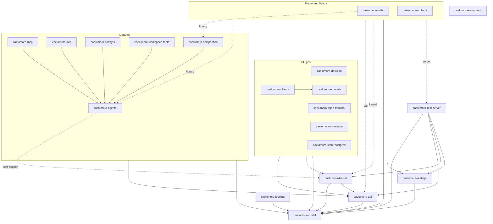

# How the crates depend on each other

What each crate holds is in [ARCHITECTURE.md](ARCHITECTURE.md#crates); this document draws how they
depend on each other, as `Cargo.toml` declares it - the normal dependencies, those a crate is built
with. The dev-dependencies, which only its tests are built with, are left out: most libraries link
`caelumora-kernel` there, with its feature `test-support`, to build the kernel's world they are
tested in.

## The graph

An arrow points from a crate to one it depends on. A dashed arrow is a dependency that is optional,
named by the feature that brings it. An arrow from a box stands for an arrow from each crate in it,
drawn so where every one of them has it.

<!-- crate-graph.sh: graph -->

<!-- crate-graph.sh: end -->

## The programs

The programs - the crates with a binary - are the composition roots: each links the plugins and the
libraries it runs with, and the crates beneath them. Drawn into the graph, their arrows would reach
every crate, so they are listed here instead, each with the crates it depends on directly, and with
those it takes with other features than their default ones.

<!-- crate-graph.sh: programs -->
| Program | Depends on |
|---|---|
| `caelumora-app` | every crate of the graph but `caelumora-rest-api` and `caelumora-rest-client` |
| `caelumora-tui` | every crate of the graph but `caelumora-rest-api`, `caelumora-rest-client` and `caelumora-rest-server`; `caelumora-artifacts` and `caelumora-skills` with `kernel` and `library` alone |
<!-- crate-graph.sh: end -->

`caelumora-rest-client` depends on no crate of the workspace, and none on it; it is reserved for a
client of the REST interface. `caelumora-web-ui` is no crate, but the browser frontend served by
`caelumora-app`.

## What the graph keeps

The graph is not only what has grown, but holds rules of the design:

*   `caelumora-model` depends on no crate of the workspace, `caelumora-api` and
    `caelumora-rest-api` on the model alone: the API is what the agent side is given of the kernel,
    the wire of the REST API is read without the server.
*   A library links the API, the model and other libraries, never the kernel (issue 516): it reaches
    the kernel through the API alone. `scripts/library-deps.sh` checks it, from the pre-commit hook,
    for the libraries and for the library side of the crates that are a plugin and a library at
    once - without their features, and with `library` alone. `caelumora-agents` links the kernel
    only with `test-support`, the feature its tests and those of other libraries build the kernel
    with.
*   A plugin links the kernel, which it extends (see [PLUGINS.md](PLUGINS.md)).
*   Nothing but the programs depends on a plugin - but a plugin that brings a backend of another
    plugin's service, as `caelumora-ollama` brings one of the models of `caelumora-models` (issue
    520) -, and only the crates that are a plugin and a library at once, with `server`, on
    `caelumora-rest-server`.

## How the graph is written

The graph and the table of the programs are written by `scripts/crate-graph.sh`, from what
`cargo metadata` reports of the manifests, between the marks `<!-- crate-graph.sh: … -->`; they are
never edited by hand, the prose around them is. A change to a manifest, to the binary of a crate or
to `scripts/crates.sh` runs the script, and the pre-commit hook refuses a commit whose document, as
it is staged, does not match the manifests (`crate-graph.sh --check`). Which box a crate is drawn in
comes from `scripts/crates.sh`, which lists the libraries, the crates on both levels and the
plugins; a new crate of one of these kinds is entered there.
