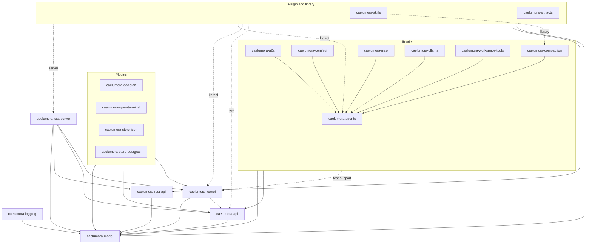

# How the crates depend on each other

What each crate holds is in [ARCHITECTURE.md](ARCHITECTURE.md#crates); this document draws how they
depend on each other, as `Cargo.toml` declares it - the normal dependencies, those a crate is built
with. The dev-dependencies, which only its tests are built with, are left out: most libraries link
`caelumora-kernel` there, with its feature `test-support`, to build the kernel's world they are
tested in.

## The graph

An arrow points from a crate to one it depends on. A dashed arrow is a dependency that is optional,
named by the feature that brings it. An arrow from a box stands for an arrow from each crate in it.



## The programs

The two programs are the composition roots: each links the plugins and the libraries it runs with,
and the crates beneath them. Drawn into the graph, their arrows would reach every crate, so they are
listed here instead, each with the crates it depends on directly.

| Program | Depends on |
|---|---|
| `caelumora-app` | every crate of the graph above, `caelumora-skills` and `caelumora-artifacts` with their default features (`kernel`, `library`, `server`) |
| `caelumora-tui` | every crate of the graph but `caelumora-rest-server` and `caelumora-rest-api`, `caelumora-skills` and `caelumora-artifacts` without `server` |

`caelumora-rest-client` depends on no crate of the workspace, and none on it; it is reserved for a
client of the REST interface. `caelumora-web-ui` is no crate, but the browser frontend served by
`caelumora-app`.

## What the graph keeps

The graph is not only what has grown, but holds rules of the design:

*   `caelumora-model` depends on no crate of the workspace, `caelumora-api` and
    `caelumora-rest-api` on the model alone: the API is what the agent side is given of the kernel,
    the wire of the REST API is read without the server.
*   A library links the API, the model and other libraries, never the kernel (issue 516): it reaches
    the kernel through the API alone. `scripts/library-deps.sh` checks it, from the pre-commit hook,
    for the libraries and for the library side of the crates that are a plugin and a library at
    once - without their features, and with `library` alone. `caelumora-agents` links the kernel
    only with `test-support`, the feature its tests and those of other libraries build the kernel
    with.
*   A plugin links the kernel, which it extends (see [PLUGINS.md](PLUGINS.md)).
*   Nothing but the programs depends on a plugin, and only the crates that are a plugin and a
    library at once, with `server`, on `caelumora-rest-server`.

## Reading the graph again

The graph above is drawn by hand from what `cargo metadata` reports. Where a change adds or drops a
dependency between crates of the workspace, it changes the graph in the same change. Every normal
dependency between them is listed by:

```sh
cargo metadata --format-version 1 --no-deps | jq -r '
  [.packages[].name] as $own
  | .packages[] | .name as $from
  | .dependencies[] | select(.kind == null and (.name | IN($own[])))
  | "\($from) -> \(.name)\(if .optional then " (optional)" else "" end)"'
```
