# How the crates depend on each other

What each crate holds is in [ARCHITECTURE.md](ARCHITECTURE.md#crates); this document draws how they
depend on each other, as `Cargo.toml` declares it - the normal dependencies, those a crate is built
with. The dev-dependencies, which only its tests are built with, are left out: most libraries link
`caelumora-kernel` there, with its feature `test-support`, to build the kernel's world they are
tested in.

## The graph

An arrow points from a crate to one it depends on. A dashed arrow is a dependency that is optional,
named by the feature that brings it. An arrow from a box stands for an arrow from each crate in it,
drawn so where every one of them has it.

```mermaid
flowchart TD
    subgraph both["Plugin and library"]
        skills["caelumora-skills"]
        artifacts["caelumora-artifacts"]
    end

    subgraph plugins["Plugins"]
        decision["caelumora-decision"]
        model["caelumora-model"]
        model_ollama["caelumora-model-ollama"]
        model_comfyui["caelumora-model-comfyui"]
        open_terminal["caelumora-open-terminal"]
        store_json["caelumora-store-json"]
        store_postgres["caelumora-store-postgres"]
    end

    subgraph libraries["Libraries"]
        agents["caelumora-agents"]
        a2a["caelumora-a2a"]
        compaction["caelumora-compaction"]
        tool_attachment["caelumora-tool-attachment"]
        tool_image["caelumora-tool-image"]
        tool_mcp["caelumora-tool-mcp"]
        tool_workspace["caelumora-tool-workspace"]
    end

    api["caelumora-api"]
    domain["caelumora-domain"]
    kernel["caelumora-kernel"]
    logging["caelumora-logging"]
    rest_api["caelumora-rest-api"]
    rest_client["caelumora-rest-client"]
    rest_server["caelumora-rest-server"]
    security["caelumora-security"]
    store["caelumora-store"]

    both -. "library" .-> agents
    both -. "api" .-> api
    skills -. "library" .-> compaction
    both --> domain
    both -. "kernel" .-> kernel
    both --> rest_api
    both -. "server" .-> rest_server
    both -. "kernel" .-> security
    both -. "kernel" .-> store
    plugins --> api
    plugins --> domain
    plugins --> kernel
    model_comfyui & model_ollama --> model
    decision & kernel & open_terminal & rest_server & store & store_json & store_postgres --> security
    a2a & compaction & tool_attachment & tool_image & tool_mcp & tool_workspace --> agents
    libraries --> api
    tool_workspace --> compaction
    libraries --> domain
    agents -. "test-support" .-> kernel
    agents -. "test-support" .-> store
    api & kernel & logging & rest_api & rest_server & security & store --> domain
    kernel & rest_server --> api
    kernel & rest_server & store_json & store_postgres --> store
    rest_server --> kernel
    rest_server --> rest_api
```

<!-- crate-graph.sh: graph -->

<!-- crate-graph.sh: end -->

## The programs

The programs - the crates with a binary - are the composition roots: each links the plugins and the
libraries it runs with, and the crates beneath them. Drawn into the graph, their arrows would reach
every crate, so they are listed here instead, each with the crates it depends on directly, and with
those it takes with other features than their default ones.

<!-- crate-graph.sh: programs -->
| Program | Depends on |
|---|---|
| `caelumora-app` | every crate of the graph but `caelumora-rest-api`, `caelumora-rest-client`, `caelumora-security` and `caelumora-store` |
| `caelumora-tui` | every crate of the graph but `caelumora-rest-api`, `caelumora-rest-client`, `caelumora-rest-server`, `caelumora-security` and `caelumora-store`; `caelumora-artifacts` and `caelumora-skills` with `kernel` and `library` alone |
<!-- crate-graph.sh: end -->

Until issue [522](../issues/522-two-crates-named-model.md), `caelumora-domain` was named
`caelumora-model`, `caelumora-model` `caelumora-models` and `caelumora-model-ollama`
`caelumora-ollama`; the issues before it name them so. Until issue
[525](../issues/525-image-models-are-a-tool-s-own.md), the backend of ComfyUI and the tool that
generates images were one library, `caelumora-comfyui`. Until issue
[531](../issues/531-workspace-tools-named-apart-from-the-tools.md), `caelumora-tool-workspace` was
named `caelumora-workspace-tools` and `caelumora-tool-mcp` `caelumora-mcp`.

`caelumora-rest-client` depends on no crate of the workspace, and none on it; it is reserved for a
client of the REST interface. `caelumora-web-ui` is no crate, but the browser frontend served by
`caelumora-app`.

## What the graph keeps

The graph is not only what has grown, but holds rules of the design:

*   `caelumora-domain` depends on no crate of the workspace, `caelumora-api` and
    `caelumora-rest-api` on the domain alone: the API is what the agent side is given of the kernel,
    the wire of the REST API is read without the server.
*   A library links the API, the domain and other libraries, never the kernel, `caelumora-security`
    or `caelumora-store` (issues 516, 517): it reaches the kernel through the API alone, and nothing
    that decides is there for it to name. `scripts/library-deps.sh` checks it, from the pre-commit
    hook, for the libraries and for the library side of the crates that are a plugin and a library
    at once - without their features, and with `library` alone. `caelumora-agents` links the kernel
    and the stores only with `test-support`, the feature its tests and those of other libraries
    build the kernel's world with.
*   A plugin links the kernel, which it extends (see [PLUGINS.md](PLUGINS.md)).
*   Nothing but the programs depends on a plugin - but a plugin that brings a backend of another
    plugin's service, as `caelumora-model-ollama` and `caelumora-model-comfyui` bring ones of the
    models of `caelumora-model` (issues 520, 525) -, and only the crates that are a plugin and a
    library at once, with `server`, on `caelumora-rest-server`.

## How a crate is named

A crate is named after its subject - `caelumora-skills`, `caelumora-compaction`,
`caelumora-decision`, `caelumora-a2a`. Two kinds of crate are named by what they are first, then by
their subject (issue 531): a backend of a service by the service - `caelumora-model-ollama` and
`caelumora-model-comfyui` of the models, `caelumora-store-json` and `caelumora-store-postgres` of
the stores -, and a library that brings an agent tools on a subject that is another's by `tool` -
`caelumora-tool-image` on the image models, `caelumora-tool-workspace` on the kernel's workspace,
`caelumora-tool-attachment` on the attachments of a channel, `caelumora-tool-mcp` on MCP servers. A
plugin that brings a service of its own with its manager is
named after its subject, though it brings tools as well, which are a part of it:
`caelumora-skills`, `caelumora-artifacts`. The name of a crate's plugin or library, and the
namespace of its texts, is the crate's name without `caelumora-`, with `_` for `-` (`tool_image`);
its type names the subject before the kind, then `Plugin` or `Library` (`ImageToolLibrary`,
`OllamaModelPlugin`).

## How the graph is written

The graph and the table of the programs are written by `scripts/crate-graph.sh`, from what
`cargo metadata` reports of the manifests, between the marks `<!-- crate-graph.sh: … -->`; they are
never edited by hand, the prose around them is. A change to a manifest, to the binary of a crate or
to `scripts/crates.sh` runs the script, and the pre-commit hook refuses a commit whose document, as
it is staged, does not match the manifests (`crate-graph.sh --check`). Which box a crate is drawn in
comes from `scripts/crates.sh`, which lists the libraries, the crates on both levels and the
plugins; a new crate of one of these kinds is entered there.
